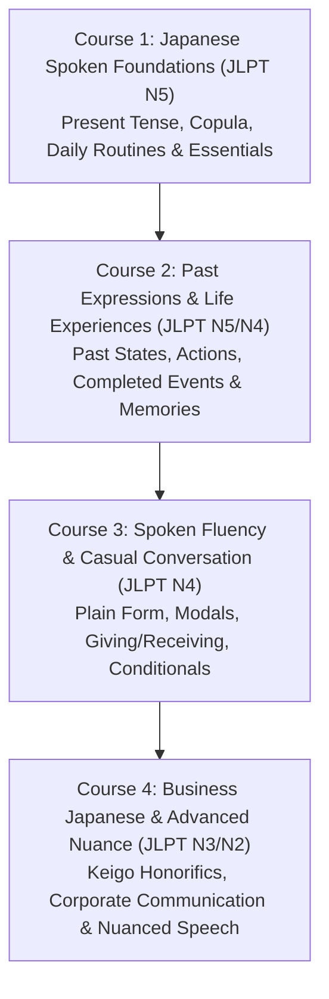

# Complete Japanese Speaking Curriculum & Implementation Plan
## (Using Assets/Japanese Contents & Spoken English Architecture)

> **Document Version:** 1.0  
> **Target Audience:** Bengali native speakers learning spoken Japanese from beginner (N5) to advanced business fluency (N2).  
> **Framework:** Based on the Spoken English Masterclass JSON schema (`spoken_english_foundations.json`, `spoken_english_past_tense.json`, `spoken_english_future_tense.json`) and the pedagogical audio-ladder methodology.

---

## 1. Executive Summary & Vision

The goal is to build the **Complete Japanese Speaking Masterclass (জাপানিজ স্পোকেন মাস্টারক্লাস)**. This system mirrors the high-retention, oral-fluency-first architecture used in our English Spoken courses, while extracting authentic grammatical patterns, high-frequency vocabulary, situational dialogues, and Kanji foundations directly from `android/app/src/main/assets/Japanese/` (N5, N4, N3, N2, and Kanji directories).

### Core Pillars Adapted from Spoken English Structure:
1. **Audio-Ladder Repetition Engine (শ্যাডোয়িং ও স্পিড ল্যাডার):**
   - Natural speed variations (0.85x slow learner speed $\rightarrow$ 1.0x normal native speech $\rightarrow$ 1.15x rapid native speech).
   - Audio sequence: **Target (Japanese Slow) $\rightarrow$ Bengali Meaning $\rightarrow$ Target (Normal) $\rightarrow$ Target (Fast) $\rightarrow$ Pause for Echo/Shadowing**.
2. **Tri-Script Multi-Layer Representation (ত্রিস্তর উপস্থাপনা):**
   - **Kanji/Kana (日本語):** Standard native writing (`わたしは学生です。` / `私は学生です。`).
   - **Furigana / Kana Reading:** Accurate phonetic reading for Kanji (`がくせい`).
   - **Romaji (উচ্চারণ নির্দেশিকা):** International phonetic standard (`Watashi wa gakusei desu.`).
   - **Bangla Phonetic (বাংলা উচ্চারণ):** Tailored for Bengali speakers (`ওয়াতাশি ওয়া গাকুসেই দেস।`).
   - **Bangla Meaning (বাংলা অর্থ):** Natural Bengali translation (`আমি একজন ছাত্র/ছাত্রী।`).
   - **Word-by-Word Tokens (টোকেন বিশ্লেষণ):** Each particle and morpheme broken down with grammatical role.
3. **6-Type Sentence Transformation Drills (৬ রূপান্তর ড্রিল):**
   - In English: Affirmative $\rightarrow$ Negative $\rightarrow$ Interrogative $\rightarrow$ Negative Interrogative $\rightarrow$ Wh-Question $\rightarrow$ Negative Wh-Question.
   - In Japanese: `です` (Affirmative) $\rightarrow$ `ではありません / じゃありません` (Negative) $\rightarrow$ `ですか` (Question) $\rightarrow$ `ではありませんか` (Negative Question) $\rightarrow$ `何 / 誰 / どこ ですか` (WH-Question) $\rightarrow$ `誰ではありませんか` (Negative WH-Question).
4. **Interactive Voice Q&A & Pair Practice (মাইক্রোফোনে ভয়েস পেয়ার প্র্যাকটিস):**
   - Direct oral prompt by AI $\rightarrow$ Student responds into microphone $\rightarrow$ Speech-to-Text & Pronunciation evaluation.
5. **Hayakuchikotoba (早口言葉 - Tongue Twisters):**
   - Targeted Japanese tongue twisters for Japanese pitch accent, double consonants (*Sokuon* っ), long vowels (*Chouon*), and contracted sounds (*Youon* きゃ, しゅ, ちょ).

---

## 2. Source Content Mapping (`assets/Japanese`)

| Source Directory | Source Files | Extracted Elements for Spoken Curriculum |
|---|---|---|
| **`assets/Japanese/N5`** | `01_Bangla_Japanese_JLPT_N5_Complete.md`<br>`01_N5_Kana_Pronunciation_Bangla.md`<br>`02_N5_Vocabulary_Counters_Bangla.md`<br>`03_N5_Grammar_Sentence_Patterns_Bangla.md`<br>`04_N5_Kanji_Master_Bangla.md`<br>`05_N5_Conversation_Reading_Bangla.md` | - Kana & Pronunciation rules, Mora timing<br>- Copula `です/ではありません`<br>- Core particles (`は, が, を, に, で, へ, と, も, の, から, まで`)<br>- Counters (`つ, 人, 本, 枚, 匹, 台, 階`), Time, Dates<br>- Existence `あります / います`<br>- Verb polite forms (`ます / ません / ました / ませんでした`)<br>- `い-Adjectives` and `な-Adjectives`<br>- Mini-Dialogues (Greetings, Restaurant, Shopping, Asking directions) |
| **`assets/Japanese/N4`** | `01_N4_Master_Bangla_Handbook.md`<br>`02_Bangla_Japanese_JLPT_N4_Complete.md`<br>`01_N4_Bangla_Japanese_800_Vocabulary.md`<br>`06_JLPT_N4-N1_Dialogues_and_Stories_Bangla.md`<br>`26_N4_Bangla_All_in_One_Complete_Collection.md` | - Plain / Casual form speaking (`タ形, 辞書形, ナイ形`)<br>- Obligation (`〜なければなりません`)<br>- Potential form (`〜ことができる / 可能動詞`)<br>- Experience (`〜たことがあります`)<br>- Giving and Receiving (`あげる / もらう / くれる`)<br>- Conditionals (`〜たら / 〜なら / 〜ば`)<br>- Passive (`受身形`) and Causative (`使役形`)<br>- Situational Dialogues (Train station, Doctor clinic, Social chats) |
| **`assets/Japanese/N3`** | `01_JLPT_N3_Reading_Bangla_Romaji.md`<br>`03_Bangla_Japanese_JLPT_N3_Complete.md`<br>`04_JLPT_N3_Dialog_Conversation_Bangla_Romaji.md` | - Intermediate conversational fluency<br>- Explaining causes & nuances (`〜わけ, 〜はず, 〜おかげで, 〜せいで`)<br>- Conversational fillers & reactions (*Aizuchi* `そうですね, なるほど, 実は`)<br>- Indirect requests & politeness (`〜ていただけませんか`) |
| **`assets/Japanese/N2`** | `04_Bangla_Japanese_JLPT_N2_Complete.md`<br>`04_N2_Dialog_Conversation_Bangla_Romaji.md`<br>`05_JLPT_N2_Complete_Preparation_Bangla_Romaji.md` | - Honorifics & Business Japanese: Keigo (`敬語`: `尊敬語` Sonkeigo & `謙譲語` Kenjougo)<br>- Business phone calls, formal meetings, job interviews<br>- Nuances (`〜に違いない, 〜ざるを得ない, 〜かねない`) |
| **`assets/Japanese/Kanji`** | `N5_Bangla_Japanese_Kanji_Book.md`<br>`N4_Bangla_Japanese_Kanji_Book.md`<br>`N5_N1_Bangla_Japanese_Complete_Kanji_Collection.md` | - High-frequency visual recognition for street signs, menus, stations, and common conversational nouns |

---

## 3. The 4-Course Japanese Spoken Series

To match our English course series (`Present Tense Foundations`, `Past Tense Masterclass`, `Future Tense Masterclass`), the Japanese Spoken curriculum is structured into **4 progressive courses**:



---

## 4. Detailed Course Syllabus Breakdown

### Course 1: Japanese Spoken Foundations (JLPT N5)
*Filename:* `spoken_japanese_foundations.json`  
*Level:* JLPT N5 / CEFR A1  
*Lessons:* 60 Lessons | ~750 Spoken Items  

#### Part 1: বর্ণমালা, উচ্চারণ ও ফ্লুয়েন্সি ড্রিল (Pronunciation, Pitch & Kana)
- **L01:** জাপানিজ স্বরবর্ণ ও মৌলিক উচ্চারণ (Vowels `あ い う え お` & Mora Timing)
- **L02:** দীর্ঘ স্বর ও দ্বিত্ব ব্যঞ্জনধ্বনি (Long Vowels & *Sokuon* っ 'Small Tsu')
- **L03:** যুক্তাক্ষর ও পরিবর্তিত ধ্বনি (*Youon* `きゃ, しゅ, ちょ` & *Dakuten* `が, ざ, だ, ば, ぱ`)
- **L04:** ৫টি জাপানিজ টাং টুইস্টার (Pronunciation Drills & *Hayakuchikotoba*):
  - *Example:* 「東京特許許可局局長」 (*Toukyou tokkyo kyokakyoku kyokuchou*)
  - *Example:* 「生麦生米生卵」 (*Nama mugi nama gome nama tamago*)

#### Part 2: পেশা, পরিচয় ও জাতীয়তা (Identity & Be-Verbs: `です / ではありません`)
- **L05:** আমার পরিচয় ও জাতীয়তা (`わたしは〜です` / I am ...)
- **L06:** অন্যের পরিচয় ও পেশা (`〜さんは〜です` / Mr./Ms. ... is a ...)
- **L07:** না-বোধক পরিচয় (`〜ではありません / じゃありません` / I am not ...)
- **L08:** ৬-রূপান্তর ড্রিল: পেশা ও পরিচয় (6 Transformations: `です` Formula)

#### Part 3: বস্তু, দাম ও অবস্থান নির্দেশক (Objects, Demonstratives & Pricing)
- **L09:** বস্তু নির্দেশ (`これ・それ・あれ・どれ` / This, That, Which)
- **L10:** বিশেষ্য সহ বস্তু নির্দেশ (`この・その・あの・どの + Noun`)
- **L11:** স্থান নির্দেশ (`ここ・そこ・あそこ・どこ` / Here, There, Where)
- **L12:** মূল্য জিজ্ঞাসা ও কেনাকাটা (`これは いくらですか` / How much is this?)
- **L13:** বস্তু পরিচিতির প্রশ্ন-উত্তর ড্রিল (Yes/No Q&A with Corrections)

#### Part 4: বৈশিষ্ট্য, অনুভূতি ও অবস্থা (`い-Adjectives` ও `な-Adjectives`)
- **L14:** `い`-বিশেষণ দিয়ে বর্তমান অবস্থা (`おおきい, ちいさい, たかい, おいしい`)
- **L15:** `い`-বিশেষণের না-বোধক রূপ (`〜くないです` / e.g., `おいしくないです`)
- **L16:** `な`-বিশেষণ দিয়ে গুণাগুণ (`しずか, きれい, げんき, ゆうめい`)
- **L17:** `な`-বিশেষণের না-বোধক রূপ (`〜じゃありません` / e.g., `きれいじゃありません`)
- **L18:** ৬-রূপান্তর ড্রিল: বিশেষণ ও অনুভূতি (6 Transformations: Adjectives)

#### Part 5: অবস্থান ও অস্তিত্ব (`あります` বনাম `います`)
- **L19:** নির্জীব বস্তু ও উদ্ভিদের অবস্থান (`[Place] に [Noun] が あります`)
- **L20:** সজীব প্রাণী ও মানুষের অবস্থান (`[Place] に [Person/Animal] が います`)
- **L21:** মালিকানা ও আছে বোঝাতে অস্তিত্বের ব্যবহার (`わたしは 車が あります`)
- **L22:** অবস্থান ও প্রিপজিশন (`うえ, した, まえ, うしろ, なか, となり`)
- **L23:** ৬-রূপান্তর ড্রিল: অস্তিত্ব ও অবস্থান (6 Transformations: Existence)

#### Part 6: দৈনন্দিন অভ্যাস ও সাধারণ কাজ (`〜ます / 〜ません` - Present Simple)
- **L24:** দৈনন্দিন কাজ ও সময় (`Time に Verb ます` / ৭টায় উঠি, ১০টায় ঘুমাই)
- **L25:** গন্তব্য ও যাতায়াত (`Place へ/に いきます / きます / かえります`)
- **L26:** সরাসরি কর্ম ও ট্রানজিটিভ ভার্ব (`Object を たべます / のみます / よみます`)
- **L27:** কাজের স্থান ও মাধ্যম (`Place で Verb` ও `Tool で Verb` / বাসে যাই, রেস্তোরাঁয় খাই)
- **L28:** না-বোধক অভ্যাস (`〜ません` / মদ পান করি না, ধূমপান করি না)
- **L29:** আমন্ত্রণ ও প্রস্তাব (`〜ませんか / 〜ましょう` / চা খাবেন কি? একসাথে যাই!)

#### Part 7: ৬-রূপান্তর মাস্টার স্পোকেন ড্রিল (6 Sentence Transformations: Action Verbs)
- **L30:** ৬-রূপান্তর ড্রিল: খাওয়া ও পান করা (`たべます` রূপান্তর)
- **L31:** ৬-রূপান্তর ড্রিল: যাওয়া ও আসা (`いきます` রূপান্তর)
- **L32:** ৬-রূপান্তর ড্রিল: অধ্যয়ন ও কাজ (`べんきょうします / はたらきます`)

#### Part 8: প্রয়োজনীয় ১০টি WH-প্রশ্ন ও উত্তর ড্রিল (10 Essential WH-Questions)
- **L33:** কী? (`何 / なん・なに` - Nan / Nani Q&A)
- **L34:** কে / কার? (`誰 / だれ` ও `だれの` - Dare / Dare no Q&A)
- **L35:** কোথায়? (`どこ` - Doko Q&A)
- **L36:** কখন? (`いつ` - Itsu Q&A)
- **L37:** কেন? (`なぜ / どうして` - Naze / Doushite Q&A)
- **L38:** কীভাবে / কেমন? (`どう / どうやって` - Dou / Dou yatte Q&A)
- **L39:** কতটি? (Counters: `いくつ / どのくらい` Q&A)
- **L40:** কতজন? (`なんにん` - Nannin Q&A)
- **L41:** কত টাকা? (`いくら` - Ikura Q&A)
- **L42:** কোন দিন / কত তারিখ? (`なんようび / なんにち` Q&A)

#### Part 9: ঘটমান কাজ ও বর্তমান অবস্থা (`〜ています` - Present Continuous)
- **L43:** বর্তমানে চলতে থাকা কাজ (`いま Verb-て います` / এখন ভাত খাচ্ছি)
- **L44:** না-বোধক ঘটমান কাজ (`Verb-て いません` / এখন পড়ছি না)
- **L45:** বর্তমান স্থায়িত্ব ও অবস্থা (`すんでいます / けっこんしています / しっています`)
- **L46:** পেশাগত কাজ চলা (`かいしゃで はたらいています / にほんごを おしえています`)

#### Part 10: ইচ্ছা, অনুরোধ, অনুমতি ও বাধ্যবাধকতা (Wants, Modals & Rules)
- **L47:** ইচ্ছা প্রকাশ (`〜たいです / 〜たくないです` / খেতে চাই, যেতে চাই না)
- **L48:** অন্যের সাথে কোনো কিছু করতে চাওয়া (`〜たいとおもいます`)
- **L49:** ভদ্র অনুরোধ (`Verb-て ください` / অনুগ্রহ করে শুনুন, বসুন)
- **L50:** অনুমতি চাওয়া ও প্রদান (`Verb-て も いいですか / いいですよ` / আসতে পারি?)
- **L51:** নিষেধাজ্ঞা (`Verb-て は いけません` / এখানে ধূমপান নিষেধ)
- **L52:** বাধ্যবাধকতা (`〜なければなりません` / ওষুধ খেতেই হবে)
- **L53:** বাধ্যবাধকতা নেই (`〜なくても いいです` / কাল না আসলেও চলবে)

#### Part 11: ইন্টারেক্টিভ ভয়েস পেয়ার প্র্যাকটিস (Voice Q&A Practice)
- **L54:** নিজের শহর ও বাসস্থান নিয়ে পেয়ার ড্রিল (Hometown & Living Voice Q&A)
- **L55:** শখ ও প্রতিদিনের রুটিন নিয়ে পেয়ার ড্রিল (Hobbies & Routines Voice Q&A)
- **L56:** রেস্তোরাঁ ও পছন্দের খাবার নিয়ে পেয়ার ড্রিল (Food & Dining Voice Q&A)
- **L57:** সময় ও যাতায়াত নিয়ে পেয়ার ড্রিল (Travel & Commute Voice Q&A)

#### Part 12: ব্যবহারিক কনভারসেশন ও মিনি-ডায়ালগ (Situational Mini-Dialogues)
- **L58:** প্রথম পরিচয় ও অভিবাদন (*Hajimemashite* Dialogue)
- **L59:** দোকানে জিনিস কেনা ও বিল পরিশোধ (Convenience Store / Supermarket)
- **L60:** স্টেশনে টিকিট কেনা ও দিক নির্দেশনা জিজ্ঞাসা (Station & Navigation)

---

### Course 2: Japanese Spoken Past & Experience (JLPT N5/N4)
*Filename:* `spoken_japanese_past_tense.json`  
*Level:* JLPT N5-N4 / CEFR A1-A2  
*Lessons:* 35 Lessons | ~400 Spoken Items  

#### Part 1: অতীতের অবস্থা, পরিচয় ও বিশেষণের অতীত রূপ (Past State & Identity)
- **L01:** অতীত পরিচয় ও অবস্থা (`でした / ではありませんでした` / Was / Was not)
- **L02:** `い`-বিশেষণের অতীত রূপ (`〜かったです / 〜くなかったです` / e.g., `あつかったです` = গরম ছিল)
- **L03:** `な`-বিশেষণের অতীত রূপ (`〜でした / 〜じゃありませんでした` / e.g., `しずかでした` = শান্ত ছিল)
- **L04:** অতীত আবহাওয়া ও অনুভূতি (Yesterday's Weather & Feelings)
- **L05:** ৬-রূপান্তর ড্রিল: অতীত অবস্থা ও পরিচয় (Past State 6 Transformations)

#### Part 2: অতীতের সমাপ্ত কাজ (`〜ました / 〜ませんでした` - Past Actions)
- **L06:** গতকালের কাজ (`きのう Verb-ました` / গতকাল জাপানিজ পড়েছিলাম)
- **L07:** অতীত না-বোধক কাজ (`きのう Verb-ませんでした` / গতকাল যাইনি)
- **L08:** কাজের মাধ্যম ও অতীত স্থান (`ともだちと レストランで たべました`)
- **L09:** ৬-রূপান্তর ড্রিল: অতীত কাজ (Past Action 6 Transformations: `いきました / たべました`)

#### Part 3: অতীত ঘটমান ও কারণ ব্যাখ্যা (`〜ていました` & `〜から / 〜ので`)
- **L10:** অতীতে কোনো সময়ে ঘটমান কাজ (`そのとき、なにを していましたか`)
- **L11:** কাজের কারণ ও অতীত যুক্তি (`〜から / 〜ので、いけませんでした` / শরীর খারাপ ছিল বলে যাইনি)
- **L12:** ধারাবাহিক অতীত ঘটনা (`Verb-て、Verb-て、Verb-ました` /起床して、朝食を食べて、出勤しました)

#### Part 4: জীবনের অভিজ্ঞতা প্রকাশ (`〜たことがあります` - Life Experience)
- **L13:** অভিজ্ঞতা জিজ্ঞাসা (`〜たことがありますか` / হ্যাভ ইউ এভার...?)
- **L14:** হ্যাঁ-বোধক ও না-বোধক অভিজ্ঞতা (`いったことがあります / いったことがありません`)
- **L15:** বিভিন্ন অভিজ্ঞতার তালিকা তৈরি (`〜たり、〜たり しました` / কেনাকাটা করলাম, সিনেমা দেখলাম)

#### Part 5: কাজ সম্পন্নের অনুভূতি ও অনিচ্ছাকৃত ভুল (`〜てしまいました` & `もう〜ました`)
- **L16:** এইমাত্র কাজ শেষ হয়েছে (`もう Verb-ました` / ইতিমধ্যে খেয়ে নিয়েছি)
- **L17:** অনিচ্ছাকৃত ভুল বা অনুশোচনা (`さいふを おとして しまいました` / মানিব্যাগ হারিয়ে ফেলেছি)
- **L18:** অতীত সমাপ্তি ও ভয়েস পেয়ার প্র্যাকটিস (Past Interactive Drills)

---

### Course 3: Japanese Spoken Fluency & Casual Conversation (JLPT N4)
*Filename:* `spoken_japanese_casual_fluency.json`  
*Level:* JLPT N4 / CEFR A2  
*Lessons:* 35 Lessons | ~420 Spoken Items  

#### Part 1: প্লেইন ফর্ম ও বন্ধুমহলের ভাষা (Casual / Plain Japanese Speaking)
- **L01:** সাধারণ বর্তমান ও ভবিষ্যৎ প্লেইন রূপ (*Dictionary Form* `食べる / 行く`)
- **L02:** সাধারণ না-বোধক প্লেইন রূপ (*Nai-Form* `食べない / 行かない`)
- **L03:** সাধারণ অতীত প্লেইন রূপ (*Ta-Form* `食べた / 行った / 食べなかった`)
- **L04:** বন্ধুমহলে প্রশ্নের ধরন (কথোপকথনে `か` বাদ দিয়ে স্বরের ওঠানামা / `行く？` - যাবে?)
- **L05:** ৬-রূপান্তর ড্রিল: প্লেইন ফর্ম কনভারসেশন (Plain Form 6 Transformations)

#### Part 2: সামর্থ্য ও সম্ভাবনা (`可能動詞` & `〜ことができる`)
- **L06:** জাপানিজ বলতে পারি (`にほんごが はなせます / はなすことができます`)
- **L07:** অক্ষমতা ও সীমাবদ্ধতা (`かんじが かけません / およぐことができません`)
- **L08:** সম্ভাব্যতার ভয়েস ড্রিল (Potential Verb Oral Drills)

#### Part 3: উপহার ও উপকার আদান-প্রদান (`あげる / もらう / くれる`)
- **L09:** কাউকে কিছু দেওয়া (`ともだちに プレゼントを あげました`)
- **L10:** কারো কাছ থেকে কিছু পাওয়া (`せんせいに ほんを もらいました`)
- **L11:** আমাকে কেউ কিছু দেওয়া (`ともだちが わたしに かして くれました`)
- **L12:** কারো জন্য কোনো কাজ করে দেওয়া (`Verb-て あげます / もらいます / くれます`)

#### Part 4: শর্ত, অনুমান ও মতামত (`〜たら, 〜なら, 〜と思います`)
- **L13:** যদি বা যখন ঘটে (`〜たら` Conditionals / বৃষ্টি হলে যাব না)
- **L14:** প্রসঙ্গ সাপেক্ষে শর্ত (`〜なら` / যদি জাপানে যাও, কিয়োটো যেও)
- **L15:** নিজের মতামত প্রকাশ (`〜とおもいます` / আমার মনে হয় কাল বৃষ্টি হবে)
- **L16:** পরোক্ষ উক্তি (`〜といいました` / তানাকা বাবু বলেছেন তিনি আসবেন)
- **L17:** উপদেশ ও পরামর্শ (`〜ほうがいいです` / ডাক্তারের কাছে যাওয়াই ভালো)

#### Part 5: কর্মবাচ্য ও প্রযোজক ক্রিয়া (Passive `受身` & Causative `使役`)
- **L18:** স্পোকেন প্যাসিভ রূপ (`ほめられました / あめにとられました`)
- **L19:** কাউকে দিয়ে কিছু করানো (`こどもに やさいを たべさせます`)
- **L20:** অনুমতি চাওয়া প্রযোজক রূপে (`〜させてください` / আমাকে করতে দিন)

---

### Course 4: Advanced Japanese Speaking & Business Keigo (JLPT N3/N2)
*Filename:* `spoken_japanese_business_advanced.json`  
*Level:* JLPT N3-N2 / CEFR B1-B2  
*Lessons:* 30 Lessons | ~380 Spoken Items  

#### Part 1: কেইগো ও বিনম্র ভাষা (Keigo Masterclass: Sonkeigo & Kenjougo)
- **L01:** কেইগোর প্রকারভেদ (`丁寧語` Teineigo, `尊敬語` Sonkeigo, `謙譲語` Kenjougo)
- **L02:** উচ্চপদস্থ ব্যক্তির কাজ সম্মানার্থে প্রকাশ (`いらっしゃる / おっしゃる / ご覧になる`)
- **L03:** নিজের কাজ বিনীতভাবে প্রকাশ (`参る / 申す / 拝見する / 致す`)
- **L04:** অত্যন্ত বিনম্র অনুরোধ (`〜ていただけませんでしょうか`)

#### Part 2: অফিস, কর্পোরেট ও বিজনেস কমিউনিকেশন (Business Scenarios)
- **L05:** বিজনেস টেলিফোন কথোপকথন (Answering Calls, Leaving Messages, Forwarding)
- **L06:** অফিসে মিটিংয়ে মতামত উপস্থাপন (Proposals, Agreeing & Politely Disagreeing)
- **L07:** ক্ষমা প্রার্থনা ও বিলম্বের কারণ ব্যাখ্যা (`大変申し訳ございません`)
- **L08:** ক্লায়েন্ট ও কাস্টমার ডিলিং (Greetings, Serving Tea, Farewell at Reception)

#### Part 3: প্রাকৃতিক কথ্য কৌশল ও সূক্ষ্ম অনুভূতি (Fillers, Aizuchi & Nuances)
- **L09:** প্রতিক্রিয়া ও কথোপকথন সচল রাখা (*Aizuchi*: `なるほど, おっしゃる通りです, 確かに`)
- **L10:** নিশ্চিত অনুমান বনাম অনিশ্চয়তা (`〜に違いない` vs `〜かもしれない`)
- **L11:** মনস্তাত্ত্বিক কারণ ও ফলাফল (`〜おかげで` [ধন্যবাদান্তে] vs `〜せいで` [দোষে])
- **L12:** বাস্তব জব ইন্টারভিউ প্রশ্নোত্তর প্রস্তুতি (Complete Japanese Job Interview Q&A)

---

## 5. Technical JSON Schema Specification

The Japanese course JSON files strictly adhere to our tested `schema_version: 1` structure to guarantee immediate compatibility with `ContentImporter.kt` and our Android Compose audio player.

```json
{
  "schema_version": 1,
  "course": {
    "id": "jp-spoken-foundations",
    "target_lang": "ja",
    "base_lang": "bn",
    "title_bn": "জাপানিজ স্পোকেন: Foundations (JLPT N5 বেসিক টু স্পিকিং)",
    "title_target": "Spoken Japanese: Foundations Masterclass",
    "source": "Curated from N5-N1 Japanese Study Series & Spoken English Framework",
    "note": "জাপানিজ বর্ণমালা ও উচ্চারণ, です/ではありません, দৈনন্দিন কাজ, অবস্থান, বিশেষণ, প্রশ্ন-উত্তর ও ৬-রূপান্তর ড্রিল।",
    "welcome_text": "জাপানিজ স্পোকেন মাস্টারক্লাসে আপনাকে স্বাগতম! শুনুন, জোরে জোরে বলুন এবং প্রতিদিন শ্যাডোয়িং অনুশীলন করুন।"
  },
  "ladder_default": [
    { "play": "target", "speed": 0.85 },
    { "play": "bn", "speed": 1.15 },
    { "play": "target", "speed": 0.95 },
    { "play": "target", "speed": 1.05 },
    { "play": "target", "speed": 1.15, "min_level": "A2" },
    { "pause_ms": 1200 }
  ],
  "stats": {
    "lessons": 60,
    "items": 750
  },
  "parts": [
    {
      "id": "jp-foundations-p2",
      "order": 2,
      "level": "A1",
      "title_bn": "পেশা ও পরিচয় (Be-Verbs: です / ではありません)",
      "title_target": "Professions & Identity (Desu / Dewa Arimasen)",
      "lessons": [
        {
          "id": "jp-foundations-l05",
          "order": 1,
          "title_bn": "আমার পেশা ও পরিচয় — 'わたしは〜です'",
          "title_target": "My Identity & Profession (Watashi wa ... desu)",
          "intro_bn": "নিজের পরিচয়, নাম বা পেশা প্রকাশ করতে 'わたしは [নাম/পেশা] です' ব্যবহার করা হয়। জাপানিজে 'は' হলো টপিক মার্কার (উচ্চারণ wa) এবং 'です' (desu) বাক্যকে ভদ্র ও মার্জিত করে।",
          "structure": [
            "Topic (わたしは) + Profession/Noun + です (desu)",
            "Negative: Topic (わたしは) + Profession/Noun + ではありません (dewa arimasen)"
          ],
          "source_section": "N5 Grammar 01 & 02: N1 wa N2 desu",
          "items": [
            {
              "id": "jp-prof-001",
              "concept_id": "c-watashi-wa-gakusei",
              "order": 1,
              "type": "sentence",
              "level": "A1",
              "target": "わたしは学生です。",
              "target_kana": "わたしはがくせいです。",
              "romaji": "Watashi wa gakusei desu.",
              "bn": "আমি একজন শিক্ষার্থী।",
              "bn_pron": "ওয়াতাশি ওয়া গাকুসেই দেস।",
              "ipa": "wa.ta.ɕi ɰa ɡa.kɯ.seː de.sɨ",
              "tokens": [
                { "t": "わたし", "romaji": "watashi", "kanji": "私", "bn": "আমি" },
                { "t": "は", "romaji": "wa", "kanji": "は", "bn": "হল (Topic Marker)" },
                { "t": "学生", "romaji": "gakusei", "kanji": "学生", "bn": "শিক্ষার্থী" },
                { "t": "です", "romaji": "desu", "kanji": "です", "bn": "হয় (Polite Copula)" }
              ],
              "tags": {
                "sentence_type": "assertive",
                "polarity": "affirmative",
                "tense": "present_simple",
                "jlpt": "N5"
              }
            },
            {
              "id": "jp-prof-002",
              "concept_id": "c-watashi-wa-sensei-dewa-arimasen",
              "order": 2,
              "type": "sentence",
              "level": "A1",
              "target": "わたしは先生ではありません。",
              "target_kana": "わたしわせんせいではありません。",
              "romaji": "Watashi wa sensei dewa arimasen.",
              "bn": "আমি শিক্ষক নই।",
              "bn_pron": "ওয়াতাশি ওয়া সেনসেই দেবা আরিমাসেন।",
              "ipa": "wa.ta.ɕi ɰa seɴ.seː de.ɰa a.ɾi.ma.seɴ",
              "tokens": [
                { "t": "わたし", "romaji": "watashi", "kanji": "私", "bn": "আমি" },
                { "t": "は", "romaji": "wa", "kanji": "は", "bn": "হল (Topic Marker)" },
                { "t": "先生", "romaji": "sensei", "kanji": "先生", "bn": "শিক্ষক" },
                { "t": "ではありません", "romaji": "dewa arimasen", "kanji": "ではありません", "bn": "নই (Polite Negative)" }
              ],
              "tags": {
                "sentence_type": "assertive",
                "polarity": "negative",
                "tense": "present_simple",
                "jlpt": "N5"
              }
            }
          ]
        }
      ]
    }
  ]
}
```

---

## 6. The 6-Sentence Japanese Transformation Matrix

Every grammar pattern in the spoken curriculum includes transformation drills that rewire the student's brain to form questions, negatives, and inquiries without hesitation:

| Transformation Form | English Model Pattern | Japanese Grammar Formula | Example (Student / 学生) | Example (Eat / 食べます) |
|---|---|---|---|---|
| **1. Affirmative (+)** | $S + V / Be + N$ | `A は B です` / `V-ます` | わたしは学生です。<br>*(Watashi wa gakusei desu)* | 朝ごはんを食べます。<br>*(Asagohan o tabemasu)* |
| **2. Negative (-)** | $S + don't / isn't + N$ | `A は B ではありません` / `V-ません` | わたしは学生ではありません。<br>*(Watashi wa gakusei dewa arimasen)* | 朝ごはんを食べません。<br>*(Asagohan o tabemasen)* |
| **3. Question (?)** | $Is / Do + S + ...?$ | `Sentence + か` | あなたは学生ですか。<br>*(Anata wa gakusei desu ka)* | 朝ごはんを食べますか。<br>*(Asagohan o tabemasu ka)* |
| **4. Negative Question (-?)** | $Isn't / Don't + S + ...?$ | `Negative + か` | あなたは学生ではありませんか。<br>*(Anata wa gakusei dewa arimasen ka)* | 朝ごはんを食べませんか。<br>*(Asagohan o tabemasen ka)* |
| **5. WH-Question (WH?)** | $Who / What / Where + ...?$ | `WH-Word + ですか / ますか` | あなたの仕事は何ですか。<br>*(Anata no shigoto wa nan desu ka)* | 朝ごはんに何を食べますか。<br>*(Asagohan ni nani o tabemasu ka)* |
| **6. Contrastive / Choice** | $Is it A or B?$ | `A ですか、B ですか` | 学生ですか、会社員ですか。<br>*(Gakusei desu ka, kaishain desu ka)* | パンを食べますか、ご飯を食べますか。<br>*(Pan o tabemasu ka, gohan o tabemasu ka)* |

---

## 7. Android App Integration Roadmap

### Step 1: Content Registration (`ContentImporter.kt`)
Add the new Japanese course files into the Android app asset manifest:
```kotlin
// In com.gigabyte.bookstore.learning.data.content.ContentImporter.kt
companion object {
    val ASSET_NAMES = listOf(
        "spoken_english_foundations.json",
        "spoken_english_past_tense.json",
        "spoken_english_future_tense.json",
        // Japanese Spoken Series
        "spoken_japanese_foundations.json",
        "spoken_japanese_past_tense.json",
        "spoken_japanese_casual_fluency.json",
        "spoken_japanese_business_advanced.json"
    )
}
```

### Step 2: TTS Multi-Language Engine Configuration
The Android app currently supports English (`en-US`) and Bengali (`bn-BD`). When loading a Japanese course (`target_lang: "ja"`), the TTS Engine automatically initializes `Locale.JAPANESE` or `Locale.JAPAN` for voice playback, preserving Bengali for translation echo.

### Step 3: UI Bundle & Course Cards (`HomeScreen.kt` & `CourseCard.kt`)
In `HomeScreen.kt` and `LearnHomeViewModel.kt`, create a designated **Japanese Spoken Bundle Card (জাপানিজ স্পোকেন কর্নার)** alongside the English Spoken banner, allowing one-tap enrollment and progress tracking.

---

## 8. Phased Generation & Execution Roadmap

```
[Phase 1: Foundations]  Extract N5 Markdown contents -> Build scratch/generate_japanese_foundations.py -> Produce spoken_japanese_foundations.json
[Phase 2: Past Tense]   Extract N5/N4 Past patterns  -> Build scratch/generate_japanese_past.py        -> Produce spoken_japanese_past_tense.json
[Phase 3: Fluency N4]   Extract N4 Plain Form & Roleplays -> Build scratch/generate_japanese_casual.py   -> Produce spoken_japanese_casual_fluency.json
[Phase 4: Keigo N3/N2]  Extract Business & Dialogues -> Build scratch/generate_japanese_business.py    -> Produce spoken_japanese_business_advanced.json
[Phase 5: App Wiring]   Update ContentImporter.kt & Home Banners -> Test TTS voice synthesis & audio ladder
```

### Summary of Outcomes:
- **Comprehensive:** 160 total lessons covering over 1,950 spoken audio sentences across 4 distinct levels (N5 to N2).
- **Practical:** Focuses 100% on actual spoken fluency, conversational reflex, and oral sentence transformation.
- **Rooted in Authentic Materials:** Directly utilizes all the extensive curated markdown books in `android/app/src/main/assets/Japanese/`.
- **Zero Architecture Friction:** Perfectly aligns with existing Android Spoken player, TTS speed ladder, tokenization, and database schema.
