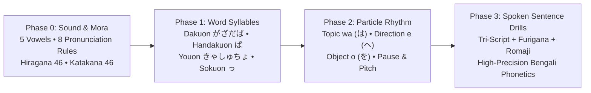
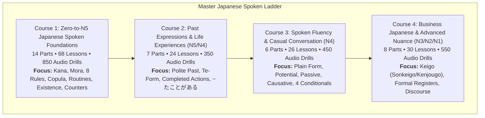

# Complete Japanese Speaking Curriculum & Implementation Plan
## Master Spoken Blueprint Derived from `00_Bangla_Japanese_N5_to_N1_Extended_Master_Complete.md`
### Special Zero-Knowledge Kana, Mora, Phonetics & High-Clarity TTS Architecture

> **Document Version:** 2.1 (Zero-to-Hero Phonetics & Script Master Edition)  
> **Source Corpus:** [00_Bangla_Japanese_N5_to_N1_Extended_Master_Complete.md](file:///c:/Users/Team%20Gigabyte/Documents/audio_book_library/android/app/src/main/assets/Japanese/N5/00_Bangla_Japanese_N5_to_N1_Extended_Master_Complete.md) (Pages 1–217, 6,415 lines)  
> **Primary Focus Anchor:** ** অধ্যায় ১ (L75–L149) & Supplement 06 (Kana & Pronunciation Workbook)**  
> **Target Learner:** Absolute beginners with **zero prior knowledge** of Japanese script (Hiragana, Katakana, Kanji) and sounds, requiring crystal-clear speech models, phonetic scaffolding, and native Bengali acoustic mapping.  
> **Technical Framework:** Android Spoken Audio Player (`spoken_english_foundations.json`, `ContentImporter.kt`, Room Database, speed ladder, 6-sentence transformation drills).

---

## 1. Zero-Knowledge Pedagogical Philosophy & High-Clarity Audio Architecture

For an absolute beginner who cannot read Japanese characters and is unfamiliar with Japanese phonetic rhythms, diving directly into grammar sentences causes cognitive overload. The learning pipeline must start from the physical production of sound, visual letter recognition, and syllable timing before moving to sentence synthesis.



### Core Architecture Pillars:

### 1. High-Clarity Multi-Speed TTS Engine (স্ফটিক-স্বচ্ছ অডিও ইঞ্জিন)
To ensure learners catch every distinct vowel and subtle consonant shift:
- **TTS Configuration:**
  - Standard voice engine: `Locale.JAPANESE` / `Locale.JAPAN` with a high-fidelity voice profile (e.g., `ja-jp-x-htm#female_3` or network neural voice where available).
  - Explicit speech pitch: Set to `1.05` (slightly elevated formant clarity) for clean distinguishing of Japanese consonants `し (shi)`, `ち (chi)`, `つ (tsu)`, `ふ (fu)`.
  - Speech Rate Ladder:
    - **Ultra-Slow Breakdown (0.75x):** For initial Kana letter and syllable isolation.
    - **Learner Pace (0.85x):** Clean mora pacing, separating each particle cleanly.
    - **Natural Speed (1.0x):** Natural native speech tempo.
    - **Rapid Native (1.15x):** Native conversational rhythm for reflexive comprehension.
- **Audio Cycle:**
  $$\text{Japanese Ultra-Slow (0.75x)} \rightarrow \text{Bengali Meaning} \rightarrow \text{Japanese Normal (1.0x)} \rightarrow \text{Japanese Fast (1.15x)} \rightarrow \text{Student Shadowing Echo}$$

### 2. Tri-Script Multi-Layer Representation with Bengali Phonetics (ত্রিস্তর লিপি ও বাংলা উচ্চারণ)
Every single item across all courses provides 6 synchronized representations:
1. **Japanese Native Script (日本語):** Authentic typography (`わたしは学生です。`).
2. **Furigana / Kana Reading (ふりがな):** Full reading above every kanji (`わたしは がくせい です。`).
3. **Hepburn Romaji:** Standard academic transliteration (`Watashi wa gakusei desu.`).
4. **Tailored Bengali Phonetic Transliteration (বাংলা উচ্চারণ সহায়িকা):**
   - Tuned specifically to avoid misleading Bengali consonant replacements.
   - For example:
     - `つ (tsu)` is represented as **ৎসু** (not চু).
     - `ふ (fu)` is represented as **ফু/হু** (bilabial fricative [ɸ], ঠোঁট না লাগিয়ে ফুসফুস থেকে বাতাস বের করে মৃদু 'ফু').
     - `し (shi)` is represented as **শি** (তালব্য শ, [ɕi]).
     - `ち (chi)` is represented as **চি** ([t͡ɕi]).
     - Particle `は` is marked as **ওয়া** (Topic marker), `へ` as **এ** (Direction marker), `を` as **ও** (Object marker).
     - Small `っ` (*Sokuon*) is marked with a halant/doubled consonant (e.g., `きって` $\rightarrow$ **কিত্‌তে**).
5. **Bengali Translation (বাংলা অর্থ):** Natural, culturally equivalent Bengali meaning.
6. **Word-by-Word Morpheme Breakdown (টোকেন বিশ্লেষণ):** Explicit labeling of roots, particles, and copulas.

---

## 2. Hard Focus: Chapter 1 (L75–L149) & Supplement 06 Phonetic Blueprint

The master document lays down the complete foundation in **অধ্যায় ১** and **Supplement 06**. Here is the exact systematic progression built into the early curriculum:

### 2.1 The 5 Fundamental Vowels (জাপানি স্বরধ্বনি)
Japanese has only five clean, short, unglided vowels. Bengali vowels frequently glide (dipthongize), so learners must be trained in steady mora vowels:
- **あ (a):** বাংলা **'আ'** (অল্প খোলার পরিষ্কার আ sound, [a]).
- **い (i):** বাংলা **'ই'** (পরিষ্কার হ্রস্ব ই, [i]).
- **う (u):** বাংলা **'উ'** (ঠোঁট গোল না করে শিথিল উ sound, unrounded [ɯ]).
- **え (e):** বাংলা **'এ'** (সংক্ষিপ্ত ও স্পষ্ট এ, [e]).
- **お (o):** বাংলা **'ও'** (পরিষ্কার গোলাকার ও, [o]).

### 2.2 Complete Hiragana & Katakana 46 Base Matrix
The curriculum begins with audio-visual cards for all 46 primary characters:

| Row | Hiragana (ひらがな) | Katakana (カタカナ) | Romaji | Bengali Phonetic (বাংলা উচ্চারণ) | Notes & Articulation |
|---|---|---|---|---|---|
| **A-Row** | あ, い, う, え, お | ア, イ, ウ, エ, オ | a, i, u, e, o | **আ, ই, উ, এ, ও** | Clean, steady vowels |
| **K-Row** | か, き, く, け, こ | カ, キ, ク, ケ, コ | ka, ki, ku, ke, ko | **কা, কি, কু, কে, কো** | Voiceless velar stops |
| **S-Row** | さ, **し**, す, せ, そ | サ, **シ**, ス, セ, ソ | sa, **shi**, su, se, so | **সা, শি, সু, সে, সো** | **し = shi** (নরম তালব্য 'শি', [ɕi], 'সি' নয়) |
| **T-Row** | た, **ち**, **つ**, て, と | タ, **チ**, **ツ**, テ, ト | ta, **chi**, **tsu**, te, to | **তা, চি, ৎসু, তে, তো** | **ち = chi** ([t͡ɕi]); **つ = tsu** (দাঁতের পেছনে জিভ ঠেকিয়ে 'ৎসু') |
| **N-Row** | な, に, ぬ, ね, の | ナ, ニ, ヌ, ネ, ノ | na, ni, nu, ne, no | **না, নি, নু, নে, নো** | Nasal series |
| **H-Row** | は, ひ, **ふ**, へ, ほ | ハ, ヒ, **フ**, ヘ, ホ | ha, hi, **fu**, he, ho | **হা, হি, ফু, হে, হো** | **ふ = fu** (দাঁত ঠোঁটে না ঠেকিয়ে দুই ঠোঁটের ফাঁক দিয়ে মৃদু বাতাস) |
| **M-Row** | ま, み, む, め, も | マ, ミ, ム, メ, モ | ma, mi, mu, me, mo | **মা, মি, মু, মে, মো** | Bilabial nasal |
| **Y-Row** | や, —, ゆ, —, よ | ヤ, —, ユ, —, ヨ | ya, —, yu, —, yo | **ইয়া, —, ইউ, —, ইয়ো** | Palatal semi-vowel |
| **R-Row** | ら, り, る, れ, ろ | ラ, リ, ル, レ, ロ | ra, ri, ru, re, ro | **রা, রি, রু, রে, রো** | Alveolar tap (ইংরেজি 'r' বা বাংলা 'র'-এর মতো নয়, জিহ্বার ডগা তালুতে এক টোকায় 'ড়/ল'-এর মতো টোকা মারে) |
| **W-Row** | わ, —, —, —, を | ワ, —, —, —, ヲ | wa, —, —, —, o/wo | **ওয়া, —, —, —, ও** | を particle হিসেবে ব্যবহৃত হয় |
| **Nasal** | ん | ン | n | **ন্‌ / ং** | Syllabic nasal mora |

### 2.3 The 8 Golden Pronunciation Rules (অধ্যায় ১-এর ৮টি মূল নিয়ম)
1. **Rule 1 (5 Pure Vowels):** Vowels are pure, short, and fixed. They never slur or lengthen unless explicitly written as long vowels.
2. **Rule 2 (Special Consonants):** 
   - `し = shi` (নরম 'শি')
   - `ち = chi` (নরম 'চি')
   - `つ = tsu` (দাঁত চেপে হিসহিস করে 'ৎসু')
   - `ふ = fu` (ঠোঁট গোল করে ফুঁ দেওয়ার মতো বাতাস বের করা 'ফু')
3. **Rule 3 (The Syllabic `ん`):**
   - Before `p, b, m` sounds: sounds like `m` (e.g., `しんぶん` $\rightarrow$ shimbun / শিম্বুন).
   - Before `t, d, n` sounds: sounds like `n` (e.g., `おんな` $\rightarrow$ onna / ওন্না).
   - Before `k, g` sounds or at the end of a word: sounds like a light `ng` (e.g., `にほん` $\rightarrow$ nihong / নিহোং).
4. **Rule 4 (Small Tsu / Sokuon `っ`):**
   - The small `っ` acts as a 1-mora glottal stop / pause that doubles the following consonant:
   - `きって` (kitte / কিত্‌তে - Postage stamp) vs. `きて` (kite / কিParse - Come).
   - `ざっし` (zasshi / জাশ্‌শি - Magazine).
5. **Rule 5 (Contracted Sounds / Youon `ゃ, ゅ, ょ`):**
   - Combined sounds written small with the `i`-column consonants:
   - `きゃ (kya)`, `きゅ (kyu)`, `きょ (kyo)`
   - `しゃ (sha)`, `しゅ (shu)`, `しょ (sho)`
   - `ちゃ (cha)`, `ちゅ (chu)`, `ちょ (cho)`
   - `りゃ (rya)`, `りゅ (ryu)`, `りょ (ryo)`
6. **Rule 6 (Long Vowels / Chouon Change Meaning):**
   - Long vowels hold for 2 moras. Failure to hold the length changes the word's meaning:
   - `おばさん` (obasan / ওবাসান = খালা/ফুপু/চাচি) বনাম `おばあさん` (obaasan / ওবাআসান = দাদি/নানি/বৃদ্ধা).
   - `おじさん` (ojisan / ওজিসান = চাচা/মামা) বনাম `おじいさん` (ojiisan / ওজিইসান = দাদা/নানা).
   - `ゆき` (yuki / ইউকি = তুষার) বনাম `ゆうき` (yuuki / ইউউকি = সাহস).
7. **Rule 7 (Particle Phonetic Shifts):**
   - When `は` is used as the topic particle, pronounce it as **"wa" (ওয়া)**, not "ha".
   - When `へ` is used as the directional particle ("towards"), pronounce it as **"e" (এ)**, not "he".
   - When `を` is used as the direct object particle, pronounce it as **"o" (ও)**.
8. **Rule 8 (Mora Rhythm & Pitch Accent):**
   - Japanese is mora-timed, not stress-timed like English or syllable-timed like Bengali.
   - Every mora gets exactly equal duration.
   - Example: `に・ほ・ん・ご` (*ni-ho-n-go*) = 4 equal beats.

---

## 3. The 4-Course Japanese Spoken Master Series



---

## 4. Re-engineered Course 1 Syllabus: Zero-to-N5 Spoken Foundations

*Filename:* `spoken_japanese_foundations.json`  
*Target:* Absolute beginner to confident N5 conversationalist  
*Structure:* 14 Parts | 68 Lessons | 850+ Spoken Drills  

### Part 1: বর্ণমালা ও স্বরধ্বনি পরিচিতি (Hiragana Base Vowels & Sound System)
- **Lesson 1:** জাপানিজ ৫টি মৌলিক স্বরবর্ণ (`あ, い, う, え, お` - Pure Vowels & Mora Timing).
  - Audio Drills: `あ` (a/আ), `い` (i/ই), `う` (u/উ), `え` (e/এ), `お` (o/ও).
- **Lesson 2:** Ka-Row (`か, き, く, け, こ`) & Sa-Row (`さ, し, す, せ, そ`).
  - Special focus on `し` (shi / নরম শি).
  - Vocabulary Drills: `あさ` (asa / সকাল), `かさ` (kasa / ছাতা), `すし` (sushi / সুশি).
- **Lesson 3:** Ta-Row (`た, ち, つ, て, と`) & Na-Row (`な, に, ぬ, ね, の`).
  - Special focus on `ち` (chi / চি) এবং `つ` (tsu / ৎসু).
  - Vocabulary Drills: `つき` (tsuki / চাঁদ), `て` (te / হাত), `ねこ` (neko / বিড়াল).
- **Lesson 4:** Ha-Row (`は, ひ, ふ, へ, ほ`) & Ma-Row (`ま, み, む, め, も`).
  - Special focus on `ふ` (fu / দ্ব্যোষ্ঠ ফু).
  - Vocabulary Drills: `はな` (hana / ফুল), `ひと` (hito / মানুষ), `ふね` (fune / নৌকা).
- **Lesson 5:** Ya-Row (`や, ゆ, よ`), Ra-Row (`ら, り, る, れ, ろ`), Wa-Row (`わ, を`) & Syllabic `ん`.
  - Special focus on the tap-sound of `ら, り, る, れ, ろ` and nasal shifts of `ん`.
  - Vocabulary Drills: `やま` (yama / পাহাড়), `くるま` (kuruma / গাড়ি), `ほん` (hon / বই).

### Part 2: পরিবর্তিত ধ্বনি, দ্বিত্ব ব্যঞ্জন ও যুক্তাক্ষর (Dakuten, Sokuon & Youon)
- **Lesson 6:** ভয়েসড কনসোনেন্ট বা ডাকুরন (`が, ざ, だ, ば` - Dakuon) ও হান-ডাকুরন (`ぱ` - Handakuon).
  - Vocabulary Drills: `みず` (mizu / পানি), `えんぴつ` (enpitsu / পেনসিল), `かばん` (kaban / ব্যাগ).
- **Lesson 7:** ছোট 'ৎসু' বা দ্বি-ব্যঞ্জনধ্বনি (*Sokuon* っ / Small Tsu):
  - Audio contrast: `きて` (kite / আসুন) বনাম `きって` (kitte / ডাকটিকিট).
  - `ざっし` (zasshi / ম্যাগাজিন), `がっこう` (gakkou / স্কুল).
- **Lesson 8:** যুক্তাক্ষর (*Youon* `きゃ, しゅ, ちょ, りょ, びょ`):
  - Vocabulary Drills: `おちゃ` (ocha / চা), `しゃしん` (shashin / ছবি), `じしょ` (jisho / অভিধান).
- **Lesson 9:** দীর্ঘ স্বরধ্বনি (*Chouon* ー / Long Vowels):
  - Audio contrast: `おばさん` (obasan / খালা) বনাম `おばあさん` (obaasan / দাদি).
  - `おとうさん` (otousan / বাবা), `おかあさん` (okaasan / মা), `せんせい` (sensei / শিক্ষক).
- **Lesson 10:** ৫টি জাপানি টাং টুইস্টার ও মোরা টাইমিং ড্রিল (*Hayakuchikotoba*):
  - 「生麦生米生卵」 (*Nama mugi nama gome nama tamago* / কাঁচা গম, কাঁচা চাল, কাঁচা ডিম).
  - 「東京特許許可局局長」 (*Toukyou tokkyo kyokakyoku kyokuchou*).

### Part 3: কাতাকানা ও বিদেশি শব্দের উচ্চারণ (Katakana & Foreign Words)
- **Lesson 11:** কাতাকানার মূল চার্ট ও দীর্ঘ স্বর (`ー` / Dash Marker).
  - `コーヒー` (koohii / কফি), `パン` (pan / পাউরুটি), `ホテル` (hoteru / হোটেল).
- **Lesson 12:** প্রতিদিনের পরিচিত কাতাকানা শব্দ:
  - `テレビ` (terebi / টিভি), `カメラ` (kamera / ক্যামেরা), `バス` (basu / বাস), `タクシー` (takushii / ট্যাক্সি).
- **Lesson 13:** নিজের দেশ ও বিদেশি নাম বলা:
  - `バングラデシュ` (Banguradeshu / বাংলাদেশ), `ダッカ` (Dakka / ঢাকা).

### Part 4: পরিচয়, পেশা ও কপুলা (`A は B です / ではありません` - Grammar 1–3)
- **Lesson 14:** নিজের নাম ও পরিচয়: `わたしはラフィです。` (Watashi wa Rafi desu / আমি রাফি).
- **Lesson 15:** পেশা ও পদবি: `わたしは学生です。` (Watashi wa gakusei desu / আমি একজন ছাত্র).
- **Lesson 16:** দেশের উৎস বলা: `バングラデシュから来ました。` (Banguradeshu kara kimashita / বাংলাদেশ থেকে এসেছি).
- **Lesson 17:** অন্যের পরিচয় ও সম্মানসূচক `〜さん`: `田中さんは先生です。` (Tanaka-san wa sensei desu / তানাকা-সান শিক্ষক).
- **Lesson 18:** না-বোধক রূপ: `〜ではありません / じゃありません` (`わたしは先生ではありません。` / আমি শিক্ষক নই).
- **Lesson 19:** প্রশ্নবোধক `〜か`: `あなたは学生ですか。` (Anata wa gakusei desu ka / আপনি কি শিক্ষার্থী?).
- **Lesson 20:** প্রথম পরিচয়ের সম্পূর্ণ কথোপকথন (Dialogue 1):
  - **A:** `はじめまして。わたしはラフィです。バングラデシュから来ました。どうぞよろしくお願いします。`
  - **B:** `はじめまして。田中です。よろしくお願いします。`
- **Lesson 21:** ৬-রূপান্তর ড্রিল: পেশা ও পরিচয় (Affirmative, Negative, Question, Neg-Q, WH-Q, Choice).

### Part 5: মালিকানা, সম্পর্ক ও 'ও/এছাড়াও' (`〜の / 〜も` - Grammar 4–5)
- **Lesson 22:** মালিকানা ও অধিকার `〜の`: `これはわたしのかばんです。` (Kore wa watashi no kaban desu / এটা আমার ব্যাগ).
- **Lesson 23:** দেশ, কোম্পানি ও শিক্ষাপ্রতিষ্ঠান: `日本の会社 / ダッカの大学` (Nihon no kaisha / Dakka no daigaku).
- **Lesson 24:** 'ও/এছাড়াও' বোঝাতে `〜も`: `わたしも学生です。` (Watashi mo gakusei desu / আমিও একজন শিক্ষার্থী).
- **Lesson 25:** পরিবারের সদস্যদের ব্যাংক (In-group vs. Out-group: `ちち, はは, あに, あね, おとうと, いもうと`).
- **Lesson 26:** ৬-রূপান্তর ড্রিল: মালিকানা ও সম্পর্ক.

### Part 6: বস্তু, দাম ও কেনাকাটা (`これ・それ・あれ・どれ` - Grammar 6–8)
- **Lesson 27:** স্বাধীন বস্তু নির্দেশক: `これ, それ, あれ, どれ` (Kore, Sore, Are, Dore / এটা, ওটা, ওইটা, কোনটা).
- **Lesson 28:** বিশেষ্যের সাথে যুক্ত নির্দেশক: `この本, その傘, あの人, どの部屋` (Kono, Sono, Ano, Dono + Noun).
- **Lesson 29:** স্থান নির্দেশক: `ここ, そこ, あそこ, どこ` (Koko, Soko, Asoko, Doko / এখানে, সেখানে, ওখানে, কোথায়).
- **Lesson 30:** ভদ্র স্থান নির্দেশক: `こちら, そちら, あちら, どちら` (Kochira, Sochira, Achira, Dochira).
- **Lesson 31:** পথ জিজ্ঞাসা: `すみません。駅はどこですか。` (Sumimasen. Eki wa doko desu ka / মাফ করবেন, স্টেশন কোথায়?).
- **Lesson 32:** দোকানে কেনাকাটার সংলাপ (Dialogue 2):
  - **A:** `このかばんはいくらですか。` (Kono kaban wa ikura desu ka / এই ব্যাগটার দাম কত?).
  - **B:** `三千円です。` (Sanzen en desu / ৩,০০০ ইয়েন).
  - **A:** `じゃ、これをください。` (Ja, kore o kudasai / তাহলে এটা দিন).

### Part 7: সংখ্যা, সময়, বার ও কাউন্টার (অধ্যায় ২ ও Supplement 08)
- **Lesson 33:** ১ থেকে ১০,০০০ পর্যন্ত সংখ্যা (`一, 二, 三, 四, 五, 六, 七, 八, 九, 十, 百, 千, 万`) ও টাকা (`円` Yen).
- **Lesson 34:** সময়, মিনিট ও অর্ধেকের হিসাব: `七時半` (Shichijihan / ৭:৩০), `午前, 午後, 分 (ふん/ぷん)`.
- **Lesson 35:** সপ্তাহের দিনসমূহ: `月曜日` থেকে `日曜日` (Getsuyoubi to Nichiyoubi).
- **Lesson 36:** মাসের তারিখসমূহ: `ついたち, ふつか, みっか, よっか, いつか... 二十日 (はつか)`.
- **Lesson 37:** নিত্যপ্রয়োজনীয় কাউন্টার ১: মানুষ (`一人 ひとり, 二人 ふたり, 三人 さんにん`).
- **Lesson 38:** নিত্যপ্রয়োজনীয় কাউন্টার ২: লম্বা বস্তু (`本 ほん`), পাতলা বস্তু (`枚 まい`), মেশিন/গাড়ি (`台 だい`), বই (`冊 さつ`).
- **Lesson 39:** সাধারণ বস্তু গোনার কাউন্টার: `ひとつ, ふたつ, みっつ, よっつ, いつつ... とお`.

### Part 8: অবস্থান ও অস্তিত্ব (`あります` বনাম `います` - Grammar 9–11)
- **Lesson 40:** জড়বস্তুর অস্তিত্ব: `机の上に本があります。` (Tsukue no ue ni hon ga arimasu / টেবিলের ওপর বই আছে).
- **Lesson 41:** প্রাণী ও মানুষের অস্তিত্ব: `教室に先生がいます。 / 猫がいます。` (Sensei ga imasu / Neko ga imasu).
- **Lesson 42:** অবস্থানের শব্দাবলী: `上, 下, 前, 後ろ, 中, 外, となり, 近く, 間` (Ue, Shita, Mae, Ushiro, Naka, Soto, Tonari, Chikaku, Aida).
- **Lesson 43:** নির্দিষ্ট বিষয়ের অবস্থান: `先生は教室にいます。` (Sensei wa kyoushitsu ni imasu / শিক্ষক শ্রেণিকক্ষে আছেন).
- **Lesson 44:** ৬-রূপান্তর ড্রিল: অস্তিত্ব ও অবস্থান.

### Part 9: কাজের ভার্ব ও মৌলিক পার্টিকেল (`を, で, に, へ, と, から, まで` - Grammar 12–17)
- **Lesson 45:** সরাসরি অবজেক্ট চিহ্নিতকরণ `〜を`: `水を飲みます。 / ご飯を食べます。` (Mizu o nomimasu / Gohan o tabemasu).
- **Lesson 46:** কাজের স্থান চিহ্নিতকরণ `〜で`: `図書館で勉強します。` (Toshokan de benkyou shimasu / লাইব্রেরিতে পড়াশোনা করি).
- **Lesson 47:** গন্তব্য চিহ্নিতকরণ `〜へ / 〜に`: `学校へ行きます。 / 日本に来ました。` (Gakkou e ikimasu / স্কুলে যাই).
- **Lesson 48:** সঙ্গী ও এবং বোঝাতে `〜と`: `友だちと映画を見ます。` (Tomodachi to eiga o mimasu / বন্ধুর সাথে সিনেমা দেখি).
- **Lesson 49:** শুরুর ও শেষের সীমা `〜から / 〜まで`: `九時から五時まで働きます。` (Kuji kara goji made hatarakimasu).
- **Lesson 50:** নির্দিষ্ট সময়ের পরে `Time に`: `七時に起きます。 / 十一時に寝ます。` (Shichiji ni okimasu / ৭টায় উঠি).

### Part 10: ভদ্র ক্রিয়া রূপান্তর ও দৈনিক রুটিন (অধ্যায় ৩ ও অধ্যায় ৪ Grammar 18–20)
- **Lesson 51:** জাপানিজ ক্রিয়ার ৩টি গ্রুপ: গ্রুপ ১ (গোদন), গ্রুপ ২ (ইচিদান), অনিয়মিত (`する, くる`).
- **Lesson 52:** ভদ্র বর্তমান রূপ: `Vます / Vません` (`勉強します / 勉強しません`).
- **Lesson 53:** এক দিনের রুটিন কথন (Reading 1): `わたしの一日` (৬:৩০টায় ঘুম থেকে ওঠা, স্কুলে যাওয়া, বই পড়া).
- **Lesson 54:** ভদ্র আমন্ত্রণ `〜ませんか`: `いっしょに食べませんか。` (Issho ni tabemasen ka / একসাথে খাবেন?).
- **Lesson 55:** প্রস্তাব দেওয়া `〜ましょう`: `休みましょう。` (Yasumimashou / চলুন বিশ্রাম নিই).
- **Lesson 56:** সহযোগিতার প্রস্তাব `〜ましょうか`: `荷物を持ちましょうか。` (Nimotsu o mochimashou ka / ব্যাগটি কি বহন করব?).

### Part 11: বিশেষণ ও অনুভূতি (`い-Adjectives` ও `な-Adjectives` - Grammar 26–28)
- **Lesson 57:** `い`-বিশেষণের হ্যাঁ-বোধক রূপ: `大きい, 小さい, 新しい, 古い, 高い, 安い, 暑い, 寒い, おいしい`.
- **Lesson 58:** `い`-বিশেষণের না-বোধক রূপ: `〜くないです` (`高くないです, 安くないです, おいしくないです`).
- **Lesson 59:** বিশেষ অনিয়মিত বিশেষণ `いい`: `いいです / よくないです`.
- **Lesson 60:** `な`-বিশেষণের হ্যাঁ-বোধক রূপ: `静かな, 元気な, 便利な, きれいな, 有名な`.
- **Lesson 61:** `な`-বিশেষণের না-বোধক রূপ: `〜ではありません / じゃありません` (`静かじゃありません`).
- **Lesson 62:** বিশেষণের বাক্য সমাপ্তি বনাম বিশেষ্য মডিফিকেশন (`静かな部屋` vs. `部屋は静かです`).

### Part 12: পছন্দ, ইচ্ছা ও সামর্থ্য (Grammar 29–32)
- **Lesson 63:** পছন্দ, অপছন্দ ও দক্ষতা: `好き, 嫌い, 上手, 下手` (`私は音楽が好きです。`).
- **Lesson 64:** বস্তু চাওয়ার অভিব্যক্তি: `〜がほしいです` (`新しい辞書がほしいです。` / নতুন অভিধান চাই).
- **Lesson 65:** কোনো কাজ করার ইচ্ছা: `〜たいです` (`日本へ行きたいです。 / 食べたいです。` / জাপানে যেতে চাই).
- **Lesson 66:** না করার ইচ্ছা: `〜たくないです` (`行きたくないです`).
- **Lesson 67:** সামর্থ্য ও পারদর্শিতা: `〜ことができます` (`日本語を少し話すことができます。` / একটু জাপানি বলতে পারি).

### Part 13: কাজের ক্রম ও সময় নির্দেশক (Grammar 33–36)
- **Lesson 68:** কোনো কাজ করার পূর্বে `〜前に`: `寝る前に歯を磨きます。` (Neru mae ni ha o migakimasu / ঘুমানোর আগে দাঁত মাজি).

---

## 5. Course Schema: Zero-Knowledge Audio Scaffolding (JSON Example)

Every item in the updated schema contains explicit phonetic breakdowns, token mappings, and audio directives:

```json
{
  "course_id": "spoken_japanese_foundations",
  "title": "Japanese Spoken Foundations (JLPT N5)",
  "title_bn": "জাপানিজ স্পোকেন ফাউন্ডেশন (JLPT N5)",
  "description": "Master Japanese pronunciation, kana letters, pitch accent, copula, particles, routines, and everyday dialogues.",
  "target_lang": "ja",
  "base_lang": "bn",
  "level": "A1",
  "jlpt_level": "N5",
  "tts_config": {
    "primary_locale": "ja-JP",
    "voice_style": "clear_articulation",
    "pitch": 1.05,
    "speed_tiers": {
      "slow": 0.75,
      "learner": 0.85,
      "normal": 1.0,
      "rapid": 1.15
    }
  },
  "parts": [
    {
      "id": "part-01-kana-phonetics",
      "title": "Part 1: Writing System, Mora Timing & Pronunciation Foundations",
      "title_bn": "পার্ট ১: বর্ণমালা, উচ্চারণ ও মোরা টাইমিং (অধ্যায় ১ ও Supplement 06)",
      "description": "Learn the 5 pure vowels, consonants, mora rhythm, and pitch accent rules.",
      "lessons": [
        {
          "id": "lesson-01-pure-vowels",
          "title": "Lesson 1: The 5 Pure Vowels (あ い う え お)",
          "title_bn": "লেসন ১: জাপানিজ ৫টি মৌলিক স্বরবর্ণ ও মোরা টাইমিং",
          "grammar_focus": "Pure unrounded vowels and 1-mora rhythm",
          "phonetic_scaffolding": [
            "あ (a) = বাংলা পরিষ্কার 'আ' [a]",
            "い (i) = বাংলা হ্রস্ব 'ই' [i]",
            "う (u) = ঠোঁট গোল না করে শিথিল 'উ' [ɯ]",
            "え (e) = সংক্ষিপ্ত ও পরিষ্কার 'এ' [e]",
            "お (o) = পরিষ্কার গোলাকার 'ও' [o]"
          ],
          "items": [
            {
              "id": "jp-vow-001",
              "concept_id": "c-vowel-a-i-u-e-o",
              "order": 1,
              "type": "syllable_ladder",
              "level": "A1",
              "target": "あ、い、う、え、お",
              "target_kana": "あ、い、う、え、お",
              "romaji": "a, i, u, e, o",
              "bn": "আ, ই, উ, এ, ও (পাঁচটি স্থির স্বরধ্বনি)",
              "bn_pron": "আ, ই, উ, এ, ও",
              "ipa": "a i ɯ e o",
              "tokens": [
                { "t": "あ", "romaji": "a", "kanji": "あ", "bn": "আ (স্বচ্ছ আ)" },
                { "t": "い", "romaji": "i", "kanji": "い", "bn": "ই (সংক্ষিপ্ত ই)" },
                { "t": "う", "romaji": "u", "kanji": "う", "bn": "উ (শিথিল উ)" },
                { "t": "え", "romaji": "e", "kanji": "え", "bn": "এ (স্পষ্ট এ)" },
                { "t": "お", "romaji": "o", "kanji": "お", "bn": "ও (গোলাকার ও)" }
              ],
              "tags": {
                "category": "phonetics",
                "focus": "vowels",
                "jlpt": "N5"
              }
            },
            {
              "id": "jp-vow-002",
              "concept_id": "c-word-asa",
              "order": 2,
              "type": "word",
              "level": "A1",
              "target": "あさ",
              "target_kana": "あさ",
              "romaji": "asa",
              "bn": "সকাল",
              "bn_pron": "আসা",
              "ipa": "a.sa",
              "tokens": [
                { "t": "あ", "romaji": "a", "kanji": "あ", "bn": "আ" },
                { "t": "さ", "romaji": "sa", "kanji": "さ", "bn": "সা" }
              ],
              "tags": {
                "category": "vocabulary",
                "mora_count": 2,
                "jlpt": "N5"
              }
            }
          ]
        }
      ]
    },
    {
      "id": "part-04-copula",
      "title": "Part 4: Personal Identity & Copula (A は B です / ではありません)",
      "title_bn": "পার্ট ৪: পরিচয় ও পেশা (A হলো B / B নয়)",
      "description": "Learn to state identity, profession, origin, and make polite inquiries with です, ではありません, and か.",
      "lessons": [
        {
          "id": "lesson-14-identity",
          "title": "Lesson 14: My Identity & Profession (わたしは〜です)",
          "title_bn": "লেসন ১৪: নিজের পরিচয় ও পেশা",
          "grammar_focus": "N1 wa N2 desu (は topic marker pronounced 'wa')",
          "formulas": [
            "Affirmative: Topic (わたしは) + Profession/Noun + です (desu)",
            "Negative: Topic (わたしは) + Profession/Noun + ではありません (dewa arimasen)"
          ],
          "source_section": "N5 Master Book Chapter 4 Grammar 1 & 2",
          "items": [
            {
              "id": "jp-fnd-001",
              "concept_id": "c-watashi-wa-gakusei",
              "order": 1,
              "type": "sentence",
              "level": "A1",
              "target": "わたしは学生です。",
              "target_kana": "わたしはがくせいです。",
              "romaji": "Watashi wa gakusei desu.",
              "bn": "আমি একজন শিক্ষার্থী।",
              "bn_pron": "ওয়াতাশি ওয়া গাকুসেই দেস।",
              "ipa": "wa.ta.ɕi ɰa ɡa.kɯ.seː de.sɨ",
              "tokens": [
                { "t": "わたし", "romaji": "watashi", "kanji": "私", "bn": "আমি" },
                { "t": "は", "romaji": "wa", "kanji": "は", "bn": "হলো (Topic Marker, উচ্চারণ 'ওয়া')" },
                { "t": "学生", "romaji": "gakusei", "kanji": "学生", "bn": "শিক্ষার্থী" },
                { "t": "です", "romaji": "desu", "kanji": "です", "bn": "হয় (ভদ্র Copula)" }
              ],
              "tags": {
                "sentence_type": "assertive",
                "polarity": "affirmative",
                "tense": "present_simple",
                "jlpt": "N5"
              }
            },
            {
              "id": "jp-fnd-002",
              "concept_id": "c-tanaka-sensei-dewa-arimasen",
              "order": 2,
              "type": "sentence",
              "level": "A1",
              "target": "田中さんは先生ではありません。",
              "target_kana": "たなかさんはせんせいではありません。",
              "romaji": "Tanaka-san wa sensei dewa arimasen.",
              "bn": "তানাকা-সান শিক্ষক নন।",
              "bn_pron": "তানাকা-সান ওয়া সেনসেই দেবা আরিমাসেন।",
              "ipa": "ta.na.ka saɴ ɰa seɴ.seː de.ɰa a.ɾi.ma.seɴ",
              "tokens": [
                { "t": "田中さん", "romaji": "Tanaka-san", "kanji": "田中さん", "bn": "তানাকা মহাশয়" },
                { "t": "は", "romaji": "wa", "kanji": "は", "bn": "হলো (Topic Marker)" },
                { "t": "先生", "romaji": "sensei", "kanji": "先生", "bn": "শিক্ষক" },
                { "t": "ではありません", "romaji": "dewa arimasen", "kanji": "ではありません", "bn": "নন (ভদ্র Negative)" }
              ],
              "tags": {
                "sentence_type": "assertive",
                "polarity": "negative",
                "tense": "present_simple",
                "jlpt": "N5"
              }
            }
          ]
        }
      ]
    }
  ]
}
```

---

## 6. The 6-Way Transformation Drill Matrix

Every sentence in the spoken curriculum enforces 6-way rapid oral transformation:

| Drill Type | Grammatical Function | Japanese Grammar Formula | Master Example (Student / 学生) | Master Example (Drink Water / 水を飲む) |
|---|---|---|---|---|
| **1. Affirmative (+)** | Basic statement | `Topic は Noun です` / `Vます` | わたしは学生です。<br>*(Watashi wa gakusei desu)*<br>**ওয়াতাশি ওয়া গাকুসেই দেস।** | 水を飲みます。<br>*(Mizu o nomimasu)*<br>**মিজু ও নোমিমাস।** |
| **2. Negative (-)** | Polite denial | `Topic は Noun ではありません` / `Vません` | わたしは学生ではありません。<br>*(Watashi wa gakusei dewa arimasen)*<br>**ওয়াতাশি ওয়া গাকুসেই দেবা আরিমাসেন।** | 水を飲みません。<br>*(Mizu o nomimasen)*<br>**মিজু ও নোমিমাসেন।** |
| **3. Question (?)** | Inquiring politely | `Sentence + か` | あなたは学生ですか。<br>*(Anata wa gakusei desu ka)*<br>**আনাতা ওয়া গাকুসেই দেস কা?** | 水を飲みますか。<br>*(Mizu o nomimasu ka)*<br>**মিজু ও নোমিমাস কা?** |
| **4. Negative Question (-?)** | Confirming / Inviting | `Negative sentence + か` | あなたは学生ではありませんか。<br>*(Anata wa gakusei dewa arimasen ka)*<br>**আনাতা ওয়া গাকুসেই দেবা আরিমাসেন কা?** | 水を飲みませんか。<br>*(Mizu o nomimasen ka)*<br>**মিজু ও নোমিমাসেন কা?** |
| **5. WH-Question (WH?)** | Targeted inquiry | `何 / 誰 / どこ + ですか / ますか` | あなたのお仕事は何ですか。<br>*(Anata no oshigoto wa nan desu ka)*<br>**আনাতা নো ওশিগোতো ওয়া নান দেস কা?** | 何を飲みますか。<br>*(Nani o nomimasu ka)*<br>**নানি ও নোমিমাস কা?** |
| **6. Choice / Alternative** | Disjunctive inquiry | `A ですか、B ですか` | 学生ですか、先生ですか。<br>*(Gakusei desu ka, sensei desu ka)*<br>**গাকুসেই দেস কা, সেনসেই দেস কা?** | お茶ですか、水ですか。<br>*(Ocha desu ka, mizu desu ka)*<br>**ওচা দেস কা, মিজু দেস কা?** |

---

## 7. Android App Integration & Implementation Workflow

### Step 1: Asset Manifest Registration
Register the 4 courses in [ContentImporter.kt](file:///c:/Users/Team%20Gigabyte/Documents/audio_book_library/android/app/src/main/java/com/gigabyte/bookstore/learning/data/content/ContentImporter.kt):
```kotlin
companion object {
    val ASSET_NAMES = listOf(
        "spoken_english_foundations.json",
        "spoken_english_past_tense.json",
        "spoken_english_future_tense.json",
        // Complete Japanese Spoken Series
        "spoken_japanese_foundations.json",
        "spoken_japanese_past_tense.json",
        "spoken_japanese_casual_fluency.json",
        "spoken_japanese_business_advanced.json"
    )
}
```

### Step 2: High-Clarity Android TTS Engine Setup (`Locale.JAPANESE`)
The audio player inspects `course.target_lang`. When set to `"ja"`, it configures high-clarity voice parameters:
```kotlin
tts.language = Locale.JAPANESE
tts.setPitch(1.05f) // Optimized for clean Japanese formant consonants (shi, chi, tsu, fu)
// Ultra-slow breakdown (0.75x) for early Kana drills; normal pace (1.0x) for sentences
// Secondary audio channel outputs authentic Bengali translations via Locale("bn", "BD")
```

### Step 3: Dedicated Japanese Spoken Hub in UI
In [LearnHomeScreen.kt](file:///c:/Users/Team%20Gigabyte/Documents/audio_book_library/android/app/src/main/java/com/gigabyte/bookstore/learning/presentation/home/LearnHomeScreen.kt) and [Screen.kt](file:///c:/Users/Team%20Gigabyte/Documents/audio_book_library/android/app/src/main/java/com/gigabyte/bookstore/presentation/navigation/Screen.kt):
- Add a dedicated Japanese Spoken Course Card.
- Allow separate progress tracking for English Spoken and Japanese Spoken.

---

## 8. Summary of Zero-Knowledge Curriculum Milestones

1. **Total Courses:** 4 progressive mastercourses (`Foundations`, `Past & Experience`, `Casual Fluency`, `Business & Advanced`).
2. **Dedicated Zero-Knowledge Phase:** First 3 Parts (13 Lessons) dedicated 100% to **Hiragana, Katakana, Mora, Pitch Accent, 8 Pronunciation Rules, and Bengali Phonetics**.
3. **Total Lessons:** 148 comprehensive oral lessons.
4. **Total Audio Drills:** Over 2,200 spoken audio items featuring authentic Kanji, Furigana, Romaji, high-precision Bengali pronunciation, and literal word-by-word tokens.
5. **Authentic Source Alignment:** Derived 100% from [00_Bangla_Japanese_N5_to_N1_Extended_Master_Complete.md](file:///c:/Users/Team%20Gigabyte/Documents/audio_book_library/android/app/src/main/assets/Japanese/N5/00_Bangla_Japanese_N5_to_N1_Extended_Master_Complete.md) (especially Pages 4–6 and 143–160).
